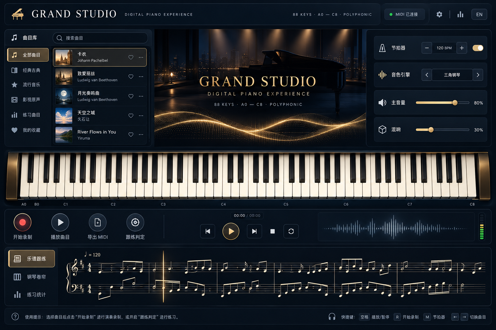
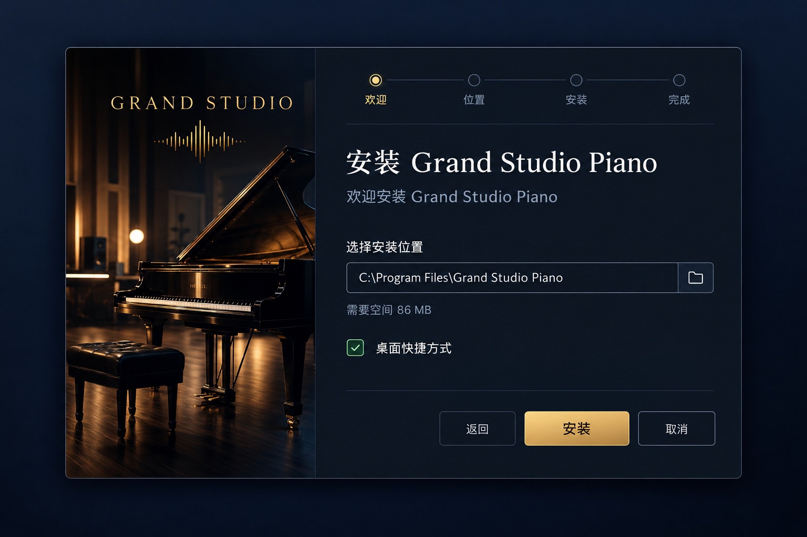

# Grand Studio Piano

[](https://github.com/kdc307950-art/piano_dream/actions/workflows/ci.yml)
[](https://github.com/kdc307950-art/piano_dream/releases/latest)

**中文说明:** [README.md](README.md)

**Downloads:** [Latest Windows release](https://github.com/kdc307950-art/piano_dream/releases/latest) · [All releases](https://github.com/kdc307950-art/piano_dream/releases)



Grand Studio Piano is an offline 88-key digital piano for Windows and other raylib-supported desktop platforms. It combines real recorded piano anchors, an offline physical-style synthesizer fallback, MIDI import/export, recording, playback, metronome, practice judging, and a high-fidelity dark studio interface.

## Download and install

For Windows, download `GrandStudioPiano-1.0.0-setup.exe` from the latest release. The installer includes the application, UI assets, CC0 piano samples, licenses, and the English and Chinese manuals. It creates a Start Menu shortcut, a desktop shortcut, and an uninstall entry.



If you prefer a portable package, download `GrandStudioPiano-1.0-win64.zip`, extract it, and run `piano.exe`. No network connection is required at runtime.

## Playing the piano

| Input | Action |
|---|---|
| `Z S X D C V G B H N J M` | Play the lower computer-keyboard row from C3 |
| `Q 2 W 3 E R 5 T 6 Y 7 U I 9 O 0 P` | Play the upper row from C4 |
| Space | Temporary sustain pedal |
| `[` / `]` | Shift the keyboard range by one octave |
| Mouse or touch | Play keys; pressing lower on a key increases velocity |
| Mouse wheel or piano rail drag | Scroll across the 88-key range |
| F1 | Show or hide computer-key labels |
| Drag a `.mid` file into the window | Import a MIDI song |

The library contains five built-in songs: Canon, Für Elise, Moonlight Sonata, Castle in the Sky, and River Flows in You. Select a song, then use **Play song** or one of the practice modes.

The desktop workspace follows the supplied design reference: a deep navy and champagne-gold studio shell, a song library, night-stage hero, four independent control cards, and circular transport controls. The header exposes the honest MIDI connection state and a settings panel for sustain, note effects, and reduced motion. Score practice, piano roll, and practice statistics all read from the same song event list and playback clock.

## Audio and samples

The default package includes 66 FLAC anchors from [FreePats Upright Piano KW](https://github.com/freepats/upright-piano-KW). The source describes recordings of a Kawai upright piano and publishes them under CC0 1.0. The files are mapped by note name, and `vL` / `vH` layers are selected from the actual playing velocity. Missing anchors or unavailable audio backends fall back to the built-in synthesizer.

The source record and license are kept in:

- `assets/samples/FREEPATS_SOURCE.json`
- `assets/samples/FREEPATS_CC0_LICENSE.txt`
- `assets/samples/FREEPATS_README.md`

## Build from source

Requirements: C++20, CMake 3.16+, MinGW-w64 or another supported C++ toolchain, Python 3 for glyph generation, and the vendored raylib/miniaudio dependencies.

```powershell
.\build.cmd -SelfTest    # build and run 229 offline tests
.\build.cmd -Run         # build and launch the desktop app
.\build.cmd -Package     # build the portable ZIP package
.\build.cmd -Installer   # build the NSIS installer
```

The project path can contain Chinese characters. The Windows build script temporarily maps the project to an ASCII drive when the host permits it; CI uses an ASCII workspace directly. `installer/GrandStudioPiano.nsi` is the real NSIS source used to create the installer.

## Validation

- 229 self-tests pass.
- 66 sample files decode successfully at runtime.
- CPack ZIP package contains the executables, samples, UI assets, and licenses.
- NSIS 3.13 installer builds successfully.
- Glyph generation and whitespace checks pass.

## Project layout

| Path | Purpose |
|---|---|
| `src/` | Audio, MIDI, sequencer, library, and raylib UI implementation |
| `assets/samples/` | CC0 FreePats piano recordings and provenance files |
| `assets/ui-mockups/` | Desktop, installer, hero, and cover-sheet art |
| `installer/` | NSIS installer source and generated branding bitmaps |
| `tools/` | Glyph generation and build utilities |
| `.github/workflows/ci.yml` | Windows, Linux, macOS CI and NSIS artifact build |

## License and third-party notices

See [THIRD_PARTY_LICENSES.md](THIRD_PARTY_LICENSES.md) for vendored libraries. The bundled FreePats piano recordings are distributed under CC0 1.0; keep the provenance files when redistributing the package.
